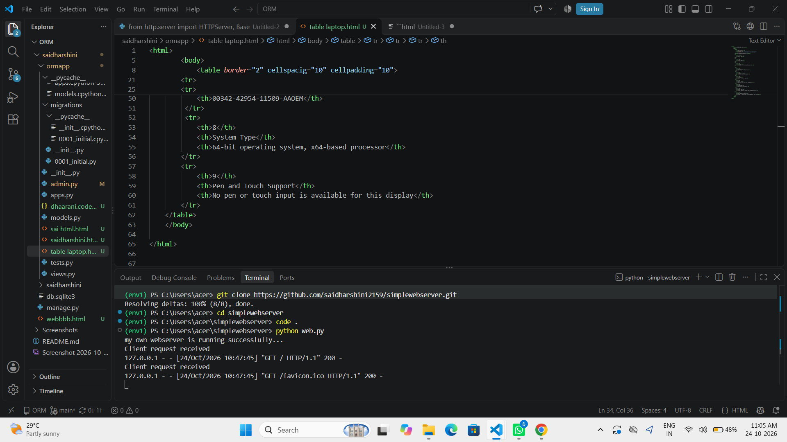

# EX01 Developing a Simple Webserver
## Date:28.09.2026

## AIM:
To develop a simple webserver to serve html pages and display the Windows Specifications of your Laptop.

## DESIGN STEPS:
### Step 1: 
HTML content creation.

### Step 2:
Design of webserver workflow.

### Step 3:
Implementation using Python code.

### Step 4:
Import the necessary modules.

### Step 5:
Define a custom request handler.

### Step 6:
Start an HTTP server on a specific port.

### Step 7:
Run the Python script to serve web pages.

### Step 8:
Serve the HTML pages.

### Step 9:
Start the server script and check for errors.

### Step 10:
Open a browser and navigate to http://127.0.0.1:8000 (or the assigned port).

## PROGRAM:
```
web.py
from http.server import HTTPServer, BaseHTTPRequestHandler
content = """
<html>
    <head>
        <title>Sample Web Page</title>
    </head>
        <body>
            <h1>Sai Dharshini</h1>
            <h1>26019085</h1>
            <table border="2" cellspacig="10" cellpadding="10">
        
        <caption>Laptop Configuration</caption>
        <tr>
            <th>S.No</th>
            <th>Device Type</th>
            <th>Device Info</th>
        </tr>
        <tr>
            <td>1</td>
            <td>Device Name</td>
            <td>TL 15-53M-G2</td>
        </tr>
        <tr>
            <td>2</td>
            <td>Processor</td>
            <td>Intel(R) Core(TM) 5 210H (2.20 GHZ)</td>
        <tr>

         <tr>
            <th>3</th>
            <th>Installed RAM</th>
            <th>16.0 GB (15.7 GB usable)</th>
         </tr>
         <tr>
            <th>4</th>
            <th>Graphics Cards</th>
            <th>Intel(R) Graphics (128MB)</th>
         </tr>
         <tr>
            <th>5</th>
            <th>Storage</th>
            <th>108 GB of 477 GB used</th>
         </tr>
         <tr>
            <th>6</th>
            <th>Device ID</th>
            <th>ADC45218-07EB-4032-87B0-1824BA4DF945</th>
         </tr>
         <tr>
            <th>7</th>
            <th>Product ID</th>
            <th>00342-42954-11509-AAOEM</th>
         </tr>
         <tr>
            <th>8</th>
            <th>System Type</th>
            <th>64-bit operating system, x64-based processor</th>
        </tr>
        <tr>
            <th>9</th>
            <th>Pen and Touch Support</th>
            <th>No pen or touch input is available for this display</th>
        </tr>
    </table>
    </body>

</html>
        


"""
class myhandler(BaseHTTPRequestHandler):
    def do_GET(self):
        print("Client request received")
        self.send_response(200)
        self.send_header('content-type', 'text/html; charset=utf-8')
        self.end_headers()
        self.wfile.write(content.encode())
server_address = ('',8000)
httpd = HTTPServer(server_address,myhandler)
print("my own webserver is running successfully...")
httpd.serve_forever()

```
## OUTPUT:
webpage


serverpage



## RESULT:
The program for implementing simple webserver is executed successfully.
